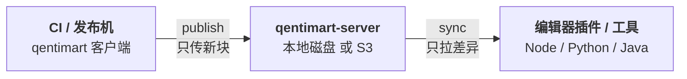

# QentimArt

**面向二进制资产的内容寻址、版本管理与增量分发系统**

服务器只存差异，下游不留缓存，为游戏素材等大体积二进制资产做版本管理与增量更新

[快速开始](docs/QUICKSTART.md) · [架构设计](docs/ARCHITECTURE.md) · [协议说明](docs/PROTOCOL.md) · [Node.js SDK](sdk/nodejs/README.md) · [Python SDK](sdk/python/README.md) · [Java SDK](sdk/java/README.md)

---

## 为什么需要 QentimArt

QentimArt 解决的是二进制资产（游戏素材、模型、打包产物等）的内容寻址、版本管理与增量分发——这和 Git 做的源码版本控制是两类不同的问题，它不是 Git 的替代品。二进制资产没法 diff、体积大、改一个像素就要整文件重存重传，下游往往也只需要某个版本的最新内容；即便用 git-lfs，本地还要再缓存一份，磁盘占用直接翻倍。

QentimArt 的取舍是：**服务器**把文件按内容切块、相同的块只存一份，每个版本只是一份清单，新版本只增加改动过的块；**下游**只保留素材本身和一个极小的元数据目录，更新时只下载变化的块，文件移动、大文件局部修改时直接复用本地已有的数据。详见 [架构设计](docs/ARCHITECTURE.md)。

## 工作原理

发布端只上传服务器还没有的块并提交一份清单；下游对比本地状态，先复用本地已有的块，再并行拉取缺少的块，写入临时文件后原子替换。完整数据流见 [架构设计](docs/ARCHITECTURE.md)。

## 特性

- **服务器只存差异**：FastCDC 内容定义分块 + SHA-256 内容寻址去重，任意历史版本都能按需拼出来
- **下游占用 ≤ 110%**：不保留对象缓存，实测磁盘占用为素材大小的 **100.04%**
- **高吞吐**：批量块接口、多连接并行、可压缩数据自动 DEFLATE、本地块复用；拉取管线实测 **375 MiB/s**
- **SemVer 版本管理**：默认拉取最新正式版，也能随时升级或降级到任意版本；版本不可变
- **安全可靠**：每个块入库和落盘前都做 SHA-256 校验；文件原子替换，中途中断不留残文件
- **灵活可配**：本地改动策略 `overwrite` / `keep` / `fail`；多项目 + `read` / `publish` / `admin` 三角色 Token 鉴权
- **两种分发方案**：动态服务端（鉴权 + 批量拉取），或零服务器静态分发（素材构建成静态树部署到 CDN / 对象存储，公开只读，默认无需鉴权）
- **零第三方依赖**：Go 单二进制服务端，存储可选本地磁盘或 S3 兼容存储（AWS S3 / MinIO / OSS / COS / R2）；三个 SDK 均无外部依赖

## 参与贡献

欢迎提交 Issue 和 Pull Request。提交前请确认测试通过（见 [快速开始 · 运行测试](docs/QUICKSTART.md#运行测试)）。代码注释与文档请使用简体中文；新增协议字段或修改本地状态格式时，请同步更新 [协议说明](docs/PROTOCOL.md) 以及 Node.js、Python、Java 三个 SDK。

## 开源许可

本项目基于 [MIT License](LICENSE) 开源
