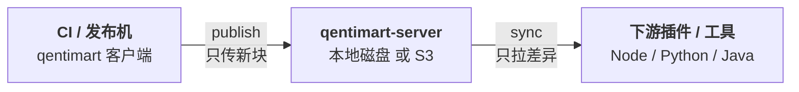

# QentimArt

**大体积二进制资产的版本管理与增量同步工具**

服务端按块去重存储，下游不留缓存目录、只拉取变更数据

[快速开始](docs/QUICKSTART.md) · [架构说明](docs/ARCHITECTURE.md) · [协议说明](docs/PROTOCOL.md) · [CDN 缓存](docs/CDN_CACHE.md) · [Node.js SDK](sdk/nodejs/README.md) · [Python SDK](sdk/python/README.md) · [Java SDK](sdk/java/README.md)

---

## 解决什么问题

游戏素材、模型、打包产物这类二进制文件体积大，也没法按行 diff。直接放进 Git 很快会把仓库撑爆；改用 git-lfs，客户端 `.git/lfs` 又要额外存一份本地缓存，磁盘占用直接翻倍。而编辑器插件、构建脚本、机器人插件等下游工具往往只需要同步到某个指定版本，根本用不上本地历史记录。

QentimArt 专门针对这类资产分发场景设计，不替代管理源码的 Git。服务端用 FastCDC 把文件切成变长数据块，按 SHA-256 去重，发新版本只补充变动过的块；客户端本地只保留业务文件和一份轻量状态清单，同步时优先复用本地已有的数据块，只下载缺失部分。具体设计见 [架构说明](docs/ARCHITECTURE.md)

## 工作流程

发布端扫描目录并切块，只上传服务端还没有的数据块，最后提交版本清单；下游对比本地文件状态，先从本地旧文件中读取可复用的数据块，再并发拉取缺失块，写完临时文件后原子替换到位。完整交互流程见 [架构说明](docs/ARCHITECTURE.md)。

## 主要特性

- **按块去重存储**：采用 FastCDC 切块与 SHA-256 内容寻址，跨文件、跨版本共享相同数据块，任意历史版本均可按清单还原
- **客户端不留缓存库**：本地没有额外的对象缓存，只有素材文件和 `.qentimart` 元数据目录，实测总占用约为素材体积的 100.04%
- **批量并发传输**：支持单次请求批量取块、多连接并发、可压缩数据自动 DEFLATE，文件改名或局部修改直接复用本地数据，纯拉取吞吐实测约 375 MiB/s
- **SemVer 版本管理**：版本号遵循 SemVer 且发布后不可覆盖，默认拉取最新正式版，也可随时升、降级到任意指定版本
- **全链路校验与原子写盘**：数据块在服务端入库和客户端落盘前均校验 SHA-256；先写临时文件再 rename 替换，进程中途退出不留损坏文件
- **冲突处理与权限划分**：同步支持 `overwrite`、`keep`、`fail` 三种本地改动处理策略；服务端支持多项目隔离与 `read`、`publish`、`admin` 三级 Token
- **支持纯静态部署**：除运行 `qentimart-server` 外，也可直接导出静态文件目录部署到 CDN、对象存储或 Cloudflare Pages，下游仅靠 HTTP `GET` 完成增量更新
- **零外部依赖**：服务端与发布工具为 Go 单文件二进制，后端支持本地磁盘与 S3 兼容存储（AWS S3、MinIO、OSS、COS、R2）；Node.js、Python、Java 三个 SDK 均只使用标准库

## 参与贡献

欢迎提交 Issue 和 Pull Request。提交前请先跑通测试（见 [快速开始 · 运行测试](docs/QUICKSTART.md#运行测试)）。代码注释与文档统一使用简体中文；若调整了协议字段或本地状态格式，请同步更新 [协议说明](docs/PROTOCOL.md) 以及 Node.js、Python、Java 三个 SDK。

## 开源许可

本项目基于 [MIT](LICENSE) 开源
