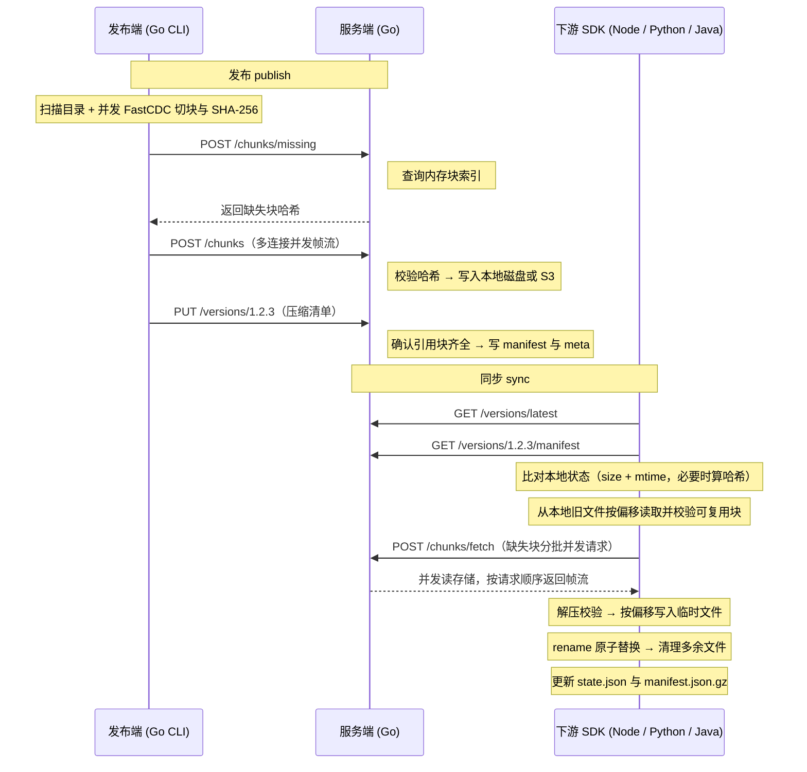

# 架构说明

## 为什么不用 Git / git-lfs

拿 Git 或 git-lfs 分发游戏素材、模型、打包产物，主要卡在磁盘占用和传输粒度两件事上：

- Git 是为按行 diff 的文本源码做的，二进制文件每改一次，`.git/objects` 就会多存一份完整副本，用久了 `.git` 比工作区大几倍。
- git-lfs 把历史挪到了远端，但拉下来以后 `.git/lfs/objects` 还要再存一份本地缓存，加上工作区本身，客户端磁盘占用直接奔着 200% 去。
- 大文件改几个字节也得整文件重下，而下游插件或构建脚本通常只要某个版本的当前文件，不需要本地保留历史。

QentimArt 把服务端版本存储和下游落盘拆开做：

1. 服务端按内容切块去重。文件用 FastCDC 切成变长块，按 SHA-256 全局去重存下来；每个版本只是一份「文件路径 → 块列表」的清单。发新版只传新增或变动的块，历史版本随时能按清单还原。
2. 下游不留块缓存。客户端目录里除了业务文件，就只有 `.qentimart/` 下的状态记录和当前清单（一般不到总大小的 0.1%）。切换版本时，新版本需要的块如果本地旧文件里已经有了，直接按偏移读出来校验复用，只去远端拉缺的那部分。

## 与其他同步工具的区别

| 工具 | 常见用途 | 增量与存储机制 | 做资产版本分发时的局限 |
|---|---|---|---|
| [**rsync**](https://rsync.samba.org/) | 服务器间目录同步 | 滚动校验切块比对，支持文件内增量和整目录同步 | 不管历史版本；依赖 rsync 守护进程或 SSH，没法直接挂普通 HTTP / CDN |
| [**zsync**](http://zsync.moria.org.uk/) | 基于 HTTP 的大文件分发 | 以本地旧文件为基准，通过 HTTP Range 只拉缺失块，服务端只需静态托管 | 只管单个大文件（比如镜像包），不支持多文件目录和版本概念；上游已长期停更 |
| [**Syncthing**](https://docs.syncthing.net/) | 多设备 P2P 双向同步 | 按块切分并校验 SHA-256，支持文件内增量和本地复用 | 面向设备间持续对等同步，不适合「CI 单向发布、大量客户端从 HTTP 拉取」，也没有不可变版本 |
| [**rclone**](https://rclone.org/commands/rclone_sync/) | 本地与云存储同步 | 支持 S3 等后端，按大小、时间戳或校验和跳过未变文件 | 按整文件传输，大文件局部改动要整文件重传；不管理版本历史 |

QentimArt 做的就是把块级去重、SemVer 不可变版本和 HTTP 分发合到一块：既可以跑 `qentimart-server` 做鉴权和批量流式拉取，也可以直接导出静态目录丢给 CDN，同时下游不背额外缓存目录。

## 两种部署方式

同一套切块、清单格式和客户端同步逻辑，对应两种后端形态：

| | 方式 A：运行服务端 | 方式 B：纯静态托管 |
|---|---|---|
| 读取时是否需要常驻进程 | 需要（`qentimart-server`） | 不需要（对象存储 / CDN / Pages） |
| 服务端职责 | Token 鉴权、入库校验、批量拼帧转发、解析 `latest`、执行 GC | 无服务端；发布端直接生成静态目录上传 |
| 发布方式 | `qentimart publish`（HTTP 接口上传） | `qentimart publish --static -o DIR`（写本地目录后用 wrangler/rsync 上传） |
| 客户端连接参数 | `server` + `project` + `token` | 站点根地址 `baseUrl` |
| 权限控制 | 内置三级 Token（read / publish / admin） | 默认公开只读；私有访问交给 CDN 或存储桶策略 |
| 取块方式 | `POST /chunks/fetch` 批量二进制帧流 | 逐块并发 `GET`（建议配合 CDN 和 HTTP/2） |
| 适用场景 | 内网环境、需要按项目隔离权限 | 公开资产分发、Cloudflare Pages、不想维护服务器 |

两种方式的底层目录结构基本一致，差别在于静态目录根下多一份预生成的 `index.json`，且去掉了多项目用的 `projects/<p>/` 前缀。客户端的差异比对、本地块复用、临时文件替换逻辑全部共用，只有版本查询和下载层不一样。

## 数据流



## 性能上的几个做法

| 环节 | 做法 |
|---|---|
| 请求合并 | 动态模式下单次请求最多拉 4096 块或 16 MiB，几万个小文件不会变成几万次 HTTP 请求 |
| 并发与连接复用 | 客户端默认开 8 路并发批次并复用长连接；服务端单批内并发读底层存储（本地磁盘 8 路，S3 32 路） |
| 减少传输量 | 块级去重；发布端对可压缩数据做 DEFLATE level 1，png、ogg、zip 等已压缩格式自动跳过；客户端先复用本地块 |
| 磁盘写入 | 预分配临时文件按偏移随机写，块乱序到达也能直接落盘；同一个块被多个文件引用时只拉一次 |
| CPU 开销 | SHA-256 调各运行时原生实现（支持硬件加速）；只有发布端跑 FastCDC，下游只做解压和校验 |
| 本地变更检测 | 已记录的文件默认只看 `size + mtime`，对得上就跳过算哈希，只对变动文件或显式指定的关键路径重算 |

## 实测数据

Windows 11（12 核），服务端和客户端同机跑，测试集 3 GB、1.26 万个文件：

| 测试项 | 结果 |
|---|---|
| 发布 1.1.0（改 5% 小文件、大包中段插数据、移动和改写部分模型） | 仅上传 17.7 MiB，服务端存储增量 18.3 MiB |
| 下游从 1.0.0 增量同步到 1.1.0 | 网络下载 17.7 MiB，本地复用 73.9 MiB，耗时不到 1 秒 |
| 下游总磁盘占用 | 素材体积的 100.04%（设计目标 ≤ 110%） |
| 纯拉取管线（网络 + 解压 + SHA-256 校验，不写盘） | 375 MiB/s |
| 全量首次同步（含写盘） | 145–250 MiB/s，主要卡在磁盘写速 |

## 客户端磁盘占用

同步完之后，目标目录的总大小就是业务素材加上 `.qentimart/` 里的两个文件：

- `state.json`：存文件路径和毫秒级修改时间，每个文件大约 50–80 字节。
- `manifest.json.gz`：gzip 压缩后的当前版本清单，每个文件大约 60–100 字节，大文件每多 1 MiB 大约多占 40 字节。

按 5 万个文件、总共 20 GB 算，元数据一共大概 10 MB，总占用约 100.05%。只有目录里塞满大量小于 1 KB 的极碎文件时，单文件几十字节的路径开销才可能逼近 10%——那种情况本来就更适合构建时先打成资源包。各 SDK 的 `sync()` 返回值和 `storageReport()` 都会报出实测占用比。

同步过程中 `.qentimart/tmp/` 会暂存正在拼装的临时文件，单批上限由 wave 控制（默认 512 MiB 或 2048 个文件，可调），每批 rename 完就删。

## 一致性与安全

- 版本发布后不可覆盖；服务端确认所有引用块都存在后，最后写 `meta.json` 作为版本生效标记。
- 每个块在服务端入库前、客户端写盘前都校验 SHA-256，防止传输损坏或投毒。
- 目标文件都在 `.qentimart/tmp/` 拼完再 `rename` 替换，中途杀进程不会留下半截文件。
- 服务端在内存里维护块索引加速查重；多实例共用同一个 S3 桶时，版本提交阶段内存没命中会回退发 S3 `HEAD` 核实，版本列表按 TTL 缓存（默认 15s）。
- 在线 GC 和静态 GC 都有宽限期（默认 1h），跳过刚写入的块，防止删掉正在发布但还没提交清单的数据。
- 客户端用 `.qentimart/lock` 文件锁（记 PID，持锁进程挂掉时自动接管陈旧锁）加进程内互斥集合，同时防跨进程和同进程多线程并发写同一个目录。
- 客户端创建父目录时逐级检查且不跟随符号链接，遇到指向目标根目录外的符号链接直接报错中止。

## 已知限制

- 动态模式下数据块下载经由服务端转发（方便统一鉴权和拼批量流）。要挂 CDN 可以直接反代并长久缓存 `GET /chunks/{hash}` 和带具体版本号的 `GET /versions/{v}/manifest`。
- 不保存也不还原符号链接和可执行权限位：发布时跳过符号链接，下游写盘遇到符号链接父目录会拒绝写入。
- 照顾 Windows 和 macOS 默认的大小写不敏感文件系统，清单里不允许同时出现仅大小写不同的路径。
- 临时文件 `rename` 只保证文件系统命名空间的原子可见性，没有逐文件 `fsync`，掉电后靠下次同步重检恢复。

## 静态托管补充说明

静态模式相当于把服务端干的活挪到了发布阶段或外部基础设施上：

- 解析最新版本：静态托管没法在请求时动态遍历目录排 SemVer，改成发布时算好写进 `index.json`。
- 访问控制：需要鉴权的话交给 CDN、对象存储预签名策略或内网网关。
- 垃圾回收：用离线命令 `qentimart gc --static` 扫本地镜像目录里所有版本的引用，删掉孤立块。

发布命令直接复用 `internal/storage` 写本地目录，块格式和动态服务端底层存储完全一样。推到 Cloudflare Pages 时 `wrangler` 按文件哈希增量上传，老块不会重传。

实际用静态模式有两点需要注意：

- 文件数量：每个块是一个独立文件。Cloudflare Pages 免费版单站点上限 20,000 个文件，大项目发几版后容易撞上限，发布时把 `-chunk-avg` 调大（比如 4 MiB）能把文件数压到四分之一，或者换对象存储 / 付费计划（上限 100,000）。
- 请求数：静态托管没有批量拼流接口，缺多少块就得发多少次 `GET`。前面挂了支持 HTTP/2 多路复用的 CDN 时很快，但如果是跨公网直连单一源站且没连接复用，小块的往返延迟会拖慢首次全量同步。以后有需要再考虑加多块合并 pack + HTTP Range，目前还没引入这套复杂度。

## 目录结构

```
cmd/qentimart-server/  服务端程序（serve、gen-token）
cmd/qentimart/         发布与运维 CLI（publish、versions、diff、delete-version、gc）
internal/              核心实现：FastCDC 切块、清单编解码、存储后端（本地 / S3）、HTTP 服务、发布管线
sdk/nodejs/            Node.js 下游 SDK、CLI 与插件示例
sdk/python/            Python 下游 SDK、CLI 与插件示例
sdk/java/              Java 下游 SDK、CLI 与 Gradle 工程
docs/                  使用与设计文档
examples/              服务端配置模板
tests/                 跨语言端到端测试与拉取吞吐基准脚本
```
