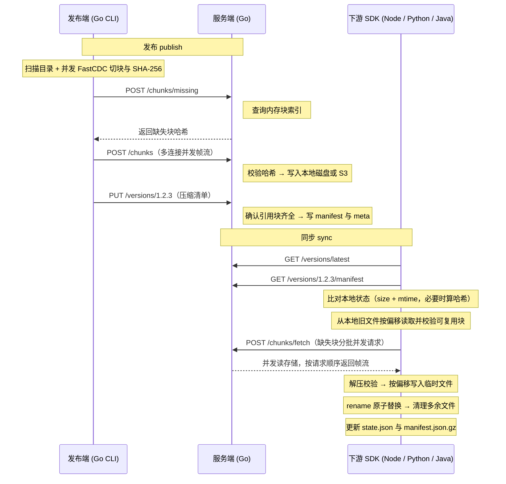

# 架构说明

## 为什么不用 Git / git-lfs

用 Git 或 git-lfs 分发游戏素材、模型和打包产物时，常见痛点集中在磁盘占用与传输粒度上：

- Git 面向可按行 diff 的文本源码设计，二进制文件每次改动都会在 `.git/objects` 中存入完整副本，迭代一久，`.git` 目录往往比工作区大出几倍
- git-lfs 虽然把历史大文件挪到了远端，但拉取时仍会在 `.git/lfs/objects` 保留一份本地缓存，算上工作区文件，下游机器需要付出约 200% 的磁盘空间
- 二进制大文件改几字节也要整文件重传，而下游插件或运行环境通常只需要某个版本的当前文件，并不需要本地保留历史记录

QentimArt 把服务端版本存储和下游文件落盘拆开处理：

1. **服务端按内容切块去重**。文件通过 FastCDC 切成变长数据块，按 SHA-256 全局去重存储；每个版本只是一份记录“文件路径 → 块列表”的清单。发布新版本只需上传新增或变动的数据块，任意历史版本都能随时按清单还原。
2. **下游不保留块缓存**。客户端目录里除了实际素材文件，只有 `.qentimart/` 下的状态记录和当前版本清单（体积通常不到素材总量的 0.1%）。版本切换时，新版本所需的块如果在本地旧文件里已经存在，就直接按文件偏移读出并校验复用，只向远端下载缺失的块。

## 与常见同步工具的对比

常见的文件同步与分发工具侧重点各有不同：

| 工具 | 常见用途 | 增量与存储机制 | 用于资产版本分发时的局限 |
|---|---|---|---|
| [**rsync**](https://rsync.samba.org/) | 服务器之间的目录同步 | 滚动校验切块比对，支持文件内增量传输与整目录同步 | 不保留历史版本；依赖 rsync 守护进程或 SSH，无法直接托管在普通 HTTP / CDN 上 |
| [**zsync**](http://zsync.moria.org.uk/) | 基于 HTTP 的大文件分发 | 客户端以本地旧文件为基准，通过 HTTP Range 只拉取缺失块，服务端只需静态文件托管 | 只针对单个大文件（如镜像包），不支持多文件目录管理，也没有版本概念；上游已长期停更 |
| [**Syncthing**](https://docs.syncthing.net/) | 多设备点对点双向同步 | 按块切分并校验 SHA-256，支持文件内增量与本地块复用 | 面向设备间持续对等同步，不适合“CI 单向发布、大量客户端从 HTTP 源拉取”的分发场景，也没有不可变版本 |
| [**rclone**](https://rclone.org/commands/rclone_sync/) | 本地与各类云存储间的文件同步 | 支持 S3 等多种存储后端，按大小、时间戳或校验和跳过未变文件 | 以整文件为单位传输，大文件局部改动仍需重传整个文件；不管理版本历史 |

QentimArt 把块级去重、SemVer 不可变版本和静态 HTTP 托管结合在一起：服务端跨文件、跨版本共享数据块，既能部署 `qentimart-server` 提供鉴权与批量流式拉取，也能直接导出纯静态目录挂到 CDN 上，同时让下游客户端保持无缓存目录的轻量占用。

## 两种部署方式

同一套切块、清单格式和客户端同步逻辑，支持两种后端形态：

| | 方式 A：运行服务端 | 方式 B：纯静态托管 |
|---|---|---|
| 读取时是否需要常驻进程 | 需要（`qentimart-server`） | 不需要（对象存储 / CDN / Pages） |
| 服务端职责 | Token 鉴权、入库校验、批量拼帧转发、解析 `latest`、执行 GC | 无服务端进程；发布端直接生成静态目录并上传 |
| 发布方式 | `qentimart publish`（HTTP 接口上传） | `qentimart publish --static -o DIR`（写入本地目录后用 wrangler/rsync 部署） |
| 客户端连接参数 | `server` + `project` + `token` | 站点根地址 `baseUrl` |
| 权限控制 | 内置三级 Token（read / publish / admin） | 默认公开只读；私有访问交由 CDN 或存储桶策略控制 |
| 取块方式 | `POST /chunks/fetch` 批量二进制帧流 | 逐块并发 `GET`（建议配合 CDN 与 HTTP/2） |
| 适用场景 | 内网环境、需要细粒度项目权限隔离 | 公开资产分发、Cloudflare Pages、不想维护服务器 |

两种方式的底层目录结构基本相同，区别在于静态目录根下多一份预生成的 `index.json`，且去掉了多项目用的 `projects/<p>/` 前缀。客户端的差异比对、本地块复用、临时文件原子替换逻辑完全共用，仅版本查询和下载传输层不同。

## 数据流



## 吞吐优化

| 环节 | 做法 |
|---|---|
| 请求合并 | 动态模式下单次请求最多拉取 4096 个块或 16 MiB 数据，几万个小文件不会拆成几万次 HTTP 请求 |
| 并发与连接复用 | 客户端默认开 8 路并发批次并复用长连接；服务端在单个批次内并发读取底层存储（本地磁盘 8 路，S3 32 路） |
| 减少传输字节 | 块级去重；发布端对可压缩数据做 DEFLATE level 1 压缩，遇到 png、ogg、zip 等已压缩格式自动跳过；客户端优先复用本地已有块 |
| 磁盘写入 | 预先分配临时文件并按偏移随机写入，数据块乱序到达也能直接落盘；同一个块被多个文件引用时只下载一次 |
| CPU 开销 | SHA-256 调用各运行时的原生实现（均支持硬件指令加速）；只有发布端需要跑 FastCDC 切块，下游只做解压和哈希校验 |
| 本地变更检测 | 已记录在案的文件默认对比 `size + mtime`，吻合则跳过哈希计算，仅对变动文件或显式指定的关键路径重算哈希 |

## 实测数据

测试环境：Windows 11（12 核），服务端与客户端同机运行，测试集共 3 GB、1.26 万个文件：

| 测试项 | 结果 |
|---|---|
| 发布 1.1.0（修改 5% 小文件、大包中段插入数据、移动及改写部分模型） | 仅上传 17.7 MiB，服务端存储增量 18.3 MiB |
| 下游从 1.0.0 增量同步到 1.1.0 | 网络下载 17.7 MiB，本地复用 73.9 MiB，耗时不到 1 秒 |
| 下游总磁盘占用 | 素材体积的 100.04%（设计目标 ≤ 110%） |
| 纯拉取管线（网络传输 + 解压 + SHA-256 校验，不写盘） | 375 MiB/s |
| 全量首次同步（含落盘写入） | 145–250 MiB/s，主要受限于测试机磁盘写速 |

## 客户端磁盘占用

同步完成后，目标目录的总大小等于业务素材加上 `.qentimart/` 目录下的两个文件：

- `state.json`：记录文件路径与毫秒级修改时间，平均每个文件约 50–80 字节
- `manifest.json.gz`：gzip 压缩后的当前版本清单，平均每个文件约 60–100 字节，大文件每增加 1 MiB 约多占 40 字节

以 5 万个文件、总计 20 GB 的项目估算，元数据一共约 10 MB，总占用约为 100.05%。只有目录里充斥大量小于 1 KB 的极碎文件时，单文件几十字节的路径开销才可能逼近 10%，这类场景更适合在构建阶段先打成资源包。各 SDK 的 `sync()` 返回结果和 `storageReport()` 都会给出实测占用比。

同步进行期间，`.qentimart/tmp/` 会存放正在拼装的临时文件，单批上限由一个 wave 控制（默认 512 MiB 或 2048 个文件，可按需调整），每批替换完成后立即删掉

## 一致性与安全设计

- 版本一旦发布不可覆盖；服务端在确认所有引用块均存在后，最后写入 `meta.json` 作为版本生效标记
- 每个数据块在服务端接收时和客户端写盘前都会校验 SHA-256，防止传输损坏或投毒
- 目标文件一律先在 `.qentimart/tmp/` 中拼装完毕，再通过 `rename` 原子替换到正式路径；同步中途进程被杀不会留下半截文件
- 服务端在内存中维护块索引以加速查重；当多个服务端实例共享同一个 S3 桶时，版本提交阶段若内存未命中会回退发 S3 `HEAD` 核实，版本列表则按 TTL 缓存（默认 15s）
- 在线 GC 与静态 GC 均设有宽限期（默认 1h），跳过近期刚写入的数据块，避免把并发发布过程中尚未提交清单的新块误删
- 客户端同步通过 `.qentimart/lock` 文件锁（记录 PID，持锁进程已退出时自动接管陈旧锁）配合进程内互斥集合，同时阻止跨进程与同进程多线程并发写同一个目录
- 客户端创建父目录时逐级检查且不跟随符号链接；一旦发现某级父目录是指向目标根目录之外的符号链接即报错中止，防止通过预置软链把文件写到目录外

## 已知限制

- 动态模式下数据块下载经由服务端转发（便于统一鉴权和拼装批量流）。如需接入 CDN，可直接反代并长久缓存 `GET /chunks/{hash}` 与带具体版本号的 `GET /versions/{v}/manifest`。
- 不保存也不还原符号链接与可执行权限位：发布扫描时跳过符号链接，下游写盘时遇到符号链接父目录会拒绝写入
- 顾及 Windows 和 macOS 默认的大小写不敏感文件系统，清单校验禁止同时存在仅大小写不同的路径
- 临时文件 `rename` 只保证文件系统命名空间的原子可见性，未逐文件执行 `fsync`，掉电场景下依赖下次同步重检恢复

## 静态托管补充说明

纯静态模式把原本由服务端进程承担的工作提前到了发布阶段或外部基础设施上：

- **解析最新版本**：静态托管无法在请求时动态遍历目录做 SemVer 排序，改为发布时算好写入 `index.json`
- **访问控制**：如需限制访问，交由 CDN 鉴权、对象存储预签名策略或内网网关处理
- **垃圾回收**：通过离线命令 `qentimart gc --static` 扫描本地镜像目录中所有版本的引用集合，清理无引用的孤立块

发布命令直接复用 `internal/storage` 写入本地静态目录，因此数据块格式与动态服务端底层存储完全相同。部署到 Cloudflare Pages 等平台时，`wrangler` 会按文件哈希增量上传，历史数据块不会重复传输。

需要注意两点工程折中：

- **文件数量**：每个数据块存成一个独立文件。Cloudflare Pages 免费版单站点上限 20,000 个文件，体积较大的项目迭代多版后可能触顶，发布时调大 `-chunk-avg`（例如设为 4 MiB）可把文件数压缩约 4 倍，或者改用对象存储及付费计划（上限 100,000）。
- **请求并发开销**：静态托管没有批量拼流接口，缺失多少个块就要发多少次 `GET`。前置 CDN 开启 HTTP/2 多路复用时速度很快，但如果跨公网直连单一源站且无连接复用优化，小块往返延迟会拖慢首次全量同步。后续如有需要可扩展多块合并包（pack 文件配合 HTTP Range 读取）进一步压低文件数与请求数，目前尚未引入这套复杂度。

## 目录结构

```
cmd/qentimart-server/  服务端程序（serve、gen-token）
cmd/qentimart/         发布与运维 CLI（publish、versions、diff、delete-version、gc）
internal/              核心实现：FastCDC 切块、清单编解码、存储后端（本地 / S3）、HTTP 服务、发布管线
sdk/nodejs/            Node.js 下游 SDK、CLI 与插件示例
sdk/python/            Python 下游 SDK、CLI 与插件示例
sdk/java/              Java 下游 SDK、CLI 与 Gradle 工程
docs/                  使用与设计文档
examples/              服务端配置模板
tests/                 跨语言端到端测试与拉取吞吐基准脚本
```
