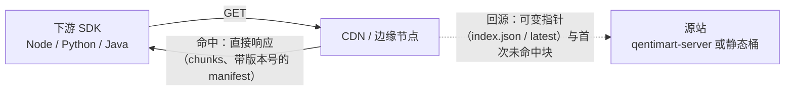

# CDN 缓存配置指南

介绍把 QentimArt 挂在 CDN 或边缘加速产品后面时如何配置缓存，并给出腾讯云 EdgeOne、阿里云 ESA 与 Cloudflare Pages 的具体做法

- [为什么 QentimArt 适合挂 CDN](#为什么-qentimart-适合挂-cdn)
- [资源缓存速查表](#资源缓存速查表)
- [通用配置原则](#通用配置原则)
- [腾讯云 EdgeOne](#腾讯云-edgeone)
- [阿里云 ESA](#阿里云-esa)
- [Cloudflare Pages](#cloudflare-pages)
- [发布新版本后的缓存处理](#发布新版本后的缓存处理)
- [开发与调试](#开发与调试)
- [注意事项](#注意事项)

## 为什么 QentimArt 适合挂 CDN

下游拉取全程只用 HTTP `GET`，而可缓存的资源天然分成泾渭分明的两类：

- **内容寻址的不可变资源**：数据块 `chunks/<哈希>` 与带具体版本号的清单 `versions/<v>/...`。URL 对应的字节由内容哈希决定，永不改变；发布新版本只会产生新的 URL，旧 URL 既不会被覆盖也不会失效。
- **唯一的可变指针**：指向最新版本的入口只有一个——静态模式下是 `index.json`，动态模式下是 `latest` 相关请求，它在每次发布后更新

由此缓存策略归结为一条原则：不可变资源永久缓存，可变指针短 TTL 或不缓存。占流量大头的数据块与历史清单都不可变，发布新版本不会触碰旧 URL，因此命中率很高，需要手动刷新的也只有那个唯一的指针。



## 资源缓存速查表

### 动态模式（运行 `qentimart-server`）

动态接口都挂在 `/api/v1/projects/{project}/` 下。服务端已对可长期缓存的响应主动带上 `Cache-Control: public, max-age=31536000, immutable`，CDN 遵循源站缓存头即可，无需额外规则：

| 请求 | 内容是否会变 | 服务端缓存头 | CDN 建议 |
|---|---|---|---|
| `GET …/chunks/{hash}` | 否（内容寻址） | `max-age=31536000, immutable` | 永久缓存，遵循源站 |
| `GET …/versions/{v}/manifest`（具体版本号） | 否 | `max-age=31536000, immutable` | 永久缓存，遵循源站 |
| `GET …/versions/latest/manifest` | 是 | 无 | 不缓存，或 ≤ 30 秒 |
| `GET …/versions/latest`、`GET …/versions` | 是 | 无 | 不缓存，或极短 TTL |
| `GET …/versions/{v}/diff?from=…` | 动态计算 | 无 | 不缓存 |
| `POST …/chunks/fetch`、`…/chunks/missing`、`…/chunks`、`PUT …/versions/{v}`、`DELETE …`、`POST …/gc` | — | — | 不缓存（POST / PUT / DELETE 默认不缓存） |

填具体版本号的 `GET …/versions/{v}` 返回的单版本元数据同样不可变，但服务端未对它带缓存头，默认按不缓存处理即可；如需减轻源站压力，可自行为带具体版本号的路径配置较长 TTL，但须将 `latest` 排除在外。

### 静态模式（纯静态目录 / Cloudflare Pages）

执行 `qentimart publish --static` 时，输出目录根下会自动生成一份 `_headers`，已写好下面的规则。只要托管平台识别 `_headers`（如 Cloudflare Pages）即无需手动配置；其他 CDN 按这张表配置即可：

| 路径 | 内容是否会变 | `_headers` 规则 | CDN 建议 |
|---|---|---|---|
| `/chunks/*` | 否 | `public, max-age=31536000, immutable` | 永久缓存 |
| `/versions/*`（`manifest.json.gz`、`meta.json`） | 否 | `public, max-age=31536000, immutable` | 永久缓存 |
| `/index.json` | 是（整棵目录里唯一会更新的文件） | `public, max-age=30, must-revalidate` | 短 TTL，≤ 30 秒 |

## 通用配置原则

无论使用哪家 CDN，配置都围绕以下几点：

- **优先遵循源站**：QentimArt 已把该带的 `Cache-Control` 写进响应头（动态服务端）或 `_headers`（静态模式），让 CDN 遵循源站即可，自定义规则只用于补齐源站未带头的路径
- **不可变资源配长 TTL**：对 `chunks/*` 与带版本号的 `versions/<v>/*` 设 365 天或更久，并尽量启用 `immutable` 语义，省去无谓的重验证
- **可变指针单独短 TTL**：仅对 `index.json`（静态）或 `latest` 相关请求（动态）设 ≤ 30 秒的 TTL 或不缓存，这是下游及时发现新版本的前提
- **忽略查询参数**：参与缓存的不可变路径不依赖任何查询参数，让缓存键忽略查询字符串可避免同一数据块因无关参数被反复缓存；`latest`、`diff` 等带参数的请求本就属于短 TTL 或不缓存一档，不在此列
- **POST 不缓存**：动态模式的批量取块是 `POST …/chunks/fetch`，默认不走缓存，需要用 CDN 卸载块流量时应改用可缓存的 `GET …/chunks/{hash}` 单块接口

## 腾讯云 EdgeOne

参考 [EdgeOne 缓存配置概述](https://cloud.tencent.com/document/product/1552/95263)，将上述原则落到各项功能上：

| EdgeOne 功能 | QentimArt 的配法 |
|---|---|
| 节点缓存 TTL | 新增两条规则：匹配 `/chunks/` 与带版本号的 `/versions/` 时遵循源站或强制很长 TTL（如 365 天），匹配 `index.json`（动态模式为 `latest`）时设 30 秒；规则按从上到下匹配，把 `index.json` / `latest` 这条放在更靠前，避免被 `/versions/*` 的长缓存规则抢先命中 |
| 自定义 Cache Key | 对参与缓存的路径选择忽略全部 URL 参数，让缓存键只由路径决定，提升去重命中率 |
| 浏览器缓存 TTL | 对不可变资源一并设较长的浏览器缓存 TTL，对 `index.json` / `latest` 保持短或不设 |
| 状态码缓存 TTL、离线缓存 | 可选；源站偶发抖动时，对不可变资源开启离线缓存可继续用边缘上的旧副本响应——这些资源永不改变，返回旧副本始终正确 |
| 清除缓存 | 发布新版本后通常只需清 `index.json`（静态）或 `latest` 相关缓存（动态），数据块与历史清单都是新 URL，无需清理，详见[下文](#发布新版本后的缓存处理) |
| 预热缓存 | 可选；大版本发布且预期有访问高峰时，可预热新版本的 `manifest` 与热点块以减少高峰期回源 |
| 缓存文件预刷新 | QentimArt 的重资源都是 `immutable`、实际不过期，预刷新意义不大，一般无需开启 |

## 阿里云 ESA

参考 [ESA 缓存入门](https://help.aliyun.com/zh/edge-security-acceleration/esa/user-guide/get-started-with-cache)，对应到各项功能：

| ESA 功能 | QentimArt 的配法 |
|---|---|
| 开发模式 | 调试、灰度阶段可临时开启，让请求绕过缓存直达源站；调试完成后应及时关闭，否则会显著增加回源流量 |
| 边缘缓存过期时间 | 用自定义规则匹配：主机名加 URI「开头为 `/chunks/`」「开头为 `/versions/`」的设长（遵循源站或 365 天），`index.json` 用 URI「等于 `/index.json`」单独设 30 秒，表达式示例见下 |
| 浏览器缓存过期时间 | 默认遵循源站 `Cache-Control` 即可，需要时对不可变资源单独延长、对可变指针保持短 |
| 忽略查询字符串、排序查询字符串 | 对参与缓存的路径开启，把带无关参数的相同 URL 视为同一缓存对象，提升命中率 |
| 多级缓存 | 推荐开启；历史版本的数据块长期不变、访问偏冷，正适合用多级缓存就近命中、层层拦截回源 |
| 缓存保持 | 推荐开启；它把低频冷访问汇聚、为对象预留空间，契合历史块不可变、长期保存、偶尔被老版本拉取的特点，可减少冷门块被淘汰后再回源的开销 |

ESA 的缓存规则通过自定义表达式匹配流量。给不可变资源配长 TTL 的那条规则，匹配表达式可写成（把域名换成自己的）：

```
http.host eq "example.com" and (starts_with(lower(http.request.uri), "/chunks/") or starts_with(lower(http.request.uri), "/versions/"))
```

关键是运算符要用「开头为」（`starts_with`）而非「等于其中任意一个」（`in`，精确匹配）。数据块与清单的实际地址是 `/chunks/<哈希前两位>/<哈希>`、`/versions/<版本号>/manifest.json.gz`，都带后续路径，精确匹配一个都命中不了。`index.json` 则相反，它是单个确定文件，用 `http.request.uri eq "/index.json"` 单独配一条 30 秒的短 TTL 规则。

静态模式下 `/versions/` 全是带具体版本号的目录、没有 `latest`，整段前缀长缓存是安全的

## Cloudflare Pages

静态模式对 Cloudflare Pages 零配置：`qentimart publish --static` 生成的 `_headers` 会被 Pages 自动识别，直接给不可变对象永久缓存、给 `index.json` 短 TTL，正常部署即可：

```bash
qentimart publish --static -o ./site -project mygame -version 1.1.0 ./Assets
```

```bash
npx wrangler pages deploy ./site
```

`wrangler` 按文件哈希增量上传，未变动的数据块不会重复传输。若改用其他 Cloudflare 产品（如把 `qentimart-server` 放在 Workers 或自定义源站后面），则按[动态模式速查表](#动态模式运行-qentimart-server)在缓存规则里配置，服务端自带的 `Cache-Control` 会被默认遵循。

> **注意文件数限制**：Cloudflare Pages 免费版单站点上限 20,000 个文件（付费版 100,000）。静态模式下每个数据块是一个文件，大项目迭代多版后可能触顶；发布时调大平均块尺寸（如 `-chunk-avg 4194304`）可把文件数压到约四分之一。详见[快速开始 · 静态模式](QUICKSTART.md#5-静态模式--cloudflare-pages)。

## 发布新版本后的缓存处理

得益于内容寻址，发布流程对缓存非常友好：

- 数据块、带版本号的清单与元数据都是新 URL，旧缓存不受影响，无需清理
- 唯一需要关注的是可变指针。指针若按建议配置了 ≤ 30 秒的短 TTL，下游最多等一个 TTL 周期即可看到新版本，通常无需手动刷新；指针若配置了较长 TTL，或需要新版本立即可见，则在发布后对单个指针执行一次缓存刷新即可——静态模式刷新 `https://<站点>/index.json`，动态模式刷新 `latest` 相关请求（`GET …/versions/latest`、`…/versions/latest/manifest`、`GET …/versions`）。

一次刷新最多涉及几个固定 URL，与版本内的文件数、数据块数无关

## 开发与调试

- 排查下游未取到新版本时，可直接请求 `index.json` / `latest` 查看返回的版本号，比对 CDN 边缘与源站是否一致
- 灰度或调试阶段如需完全绕过缓存，可开启 ESA 的开发模式或 EdgeOne 的临时不缓存规则，调试完成后关闭
- 不可变资源即使被缓存层返回损坏副本也无需依赖清缓存兜底：客户端落盘前会重算 SHA-256，校验不通过会报错并重试

## 注意事项

- 不可对 `latest` / `index.json` 配置长缓存，这是唯一配置失误即影响使用的地方：长缓存指针会导致下游长时间看不到新版本
- 区分两种 `manifest` 请求：带具体版本号的 `…/versions/<v>/manifest` 可永久缓存，`…/versions/latest/manifest` 不可；配置规则时按路径精确区分，避免用一条 `/versions/*` 通配把 `latest` 一并长缓存
- 动态模式依靠 `GET` 单块接口卸载流量：批量取块走 `POST`、默认不缓存，要让 CDN 真正分担数据块流量，需让下游走 `GET …/chunks/{hash}`，或直接采用静态模式
- 缓存键忽略查询参数仅应对不可变路径生效。全局忽略全部参数会连 `?from=`、`?prerelease=1` 一并忽略，这些请求本就属于不缓存一档、不受影响；但若对它们误配了缓存，忽略参数反而会使不同请求相互串用缓存
